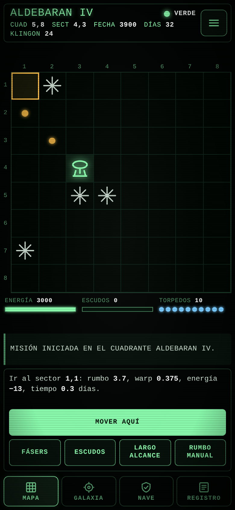

# Star Trek Mobile

A touch-first recreation of the classic *Super Star Trek* strategy game, built as an installable Progressive Web App for phones and 7-inch tablets.

Command the starship, hunt down the invading Klingon fleet across an 8×8 galaxy, and resupply at starbases, all before time runs out. The original game rules are preserved. The teletype interface is replaced by a tabbed bridge console with a quadrant map, galaxy chart, ship status and captain's log.



## Features

- Original Super Star Trek rules: energy, shields, phasers, photon torpedoes, damage control and starbases
- Tap to move, aim and fire, with torpedo courses calculated for you and a manual course/warp mode
- Layouts for portrait phones, landscape phones and 7" tablets
- Installable and fully playable offline
- Auto-save: resume your mission where you left off
- Optional retro CRT effect, sound and vibration
- Three difficulty levels
- Zero dependencies: plain HTML, CSS and JavaScript, no build step

## How to play

- **Map:** tap a sector to preview the route and energy cost, tap it again (or press *Move here*) to go. Tap a Klingon to fire a torpedo or phasers.
- **Galaxy:** tap a quadrant to travel there. Use *Long range* to scan neighbouring quadrants.
- **Ship:** energy, shields, torpedoes, time left and damage to each system.
- **Log:** the captain's log. The latest message is always shown above the controls.
- Shields start at zero, as in the original: raise them before fighting.
- Dock next to a starbase to refill energy and torpedoes and to repair damage.

## Run locally

```
python3 -m http.server 8000
```

Then open `http://localhost:8000`. Installing the app and offline mode require HTTPS (or `localhost`).

## Deploy

The project is a set of static files, so any static host works. With GitHub Pages: *Settings → Pages → Deploy from a branch → `main` / root*. Then open the site on your phone and choose *Install app* (Android/Chrome) or *Share → Add to Home Screen* (iOS/Safari).

After changing any file, bump `VERSION` in `sw.js` so installed copies update.

To build an Android package, give the published URL to [PWABuilder](https://www.pwabuilder.com).

## Project structure

| File | Purpose |
|---|---|
| `index.html`, `style.css` | Layout and styles |
| `engine.js` | Game engine (Super Star Trek rules), no UI code |
| `ui.js` | Touch interface, tabs, sound, auto-save |
| `manifest.webmanifest`, `sw.js` | PWA install data and offline support |
| `icons/`, `screenshots/` | App icons and store screenshots |

## Disclaimer

Fan-made, non-commercial tribute. Not affiliated with or endorsed by Paramount. "Star Trek" is a trademark of its respective owner. Game rules are based on the classic *Super Star Trek*, written by Bob Leedom from the original game by Mike Mayfield.
